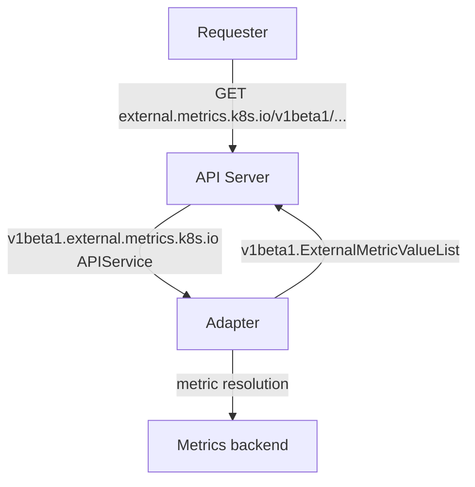

<!--
**Note:** When your KEP is complete, all of these comment blocks should be removed.

To get started with this template:

- [ ] **Pick a hosting SIG.**
  Make sure that the problem space is something the SIG is interested in taking
  up. KEPs should not be checked in without a sponsoring SIG.
- [ ] **Create an issue in kubernetes/enhancements**
  When filing an enhancement tracking issue, please make sure to complete all
  fields in that template. One of the fields asks for a link to the KEP. You
  can leave that blank until this KEP is filed, and then go back to the
  enhancement and add the link.
- [ ] **Make a copy of this template directory.**
  Copy this template into the owning SIG's directory and name it
  `NNNN-short-descriptive-title`, where `NNNN` is the issue number (with no
  leading-zero padding) assigned to your enhancement above.
- [ ] **Fill out as much of the kep.yaml file as you can.**
  At minimum, you should fill in the "Title", "Authors", "Owning-sig",
  "Status", and date-related fields.
- [ ] **Fill out this file as best you can.**
  At minimum, you should fill in the "Summary" and "Motivation" sections.
  These should be easy if you've preflighted the idea of the KEP with the
  appropriate SIG(s).
- [ ] **Create a PR for this KEP.**
  Assign it to people in the SIG who are sponsoring this process.
- [ ] **Merge early and iterate.**
  Avoid getting hung up on specific details and instead aim to get the goals of
  the KEP clarified and merged quickly. The best way to do this is to just
  start with the high-level sections and fill out details incrementally in
  subsequent PRs.

Just because a KEP is merged does not mean it is complete or approved. Any KEP
marked as `provisional` is a working document and subject to change. You can
denote sections that are under active debate as follows:

```
<<[UNRESOLVED optional short context or usernames ]>>
Stuff that is being argued.
<<[/UNRESOLVED]>>
```

When editing KEPS, aim for tightly-scoped, single-topic PRs to keep discussions
focused. If you disagree with what is already in a document, open a new PR
with suggested changes.

One KEP corresponds to one "feature" or "enhancement" for its whole lifecycle.
You do not need a new KEP to move from beta to GA, for example. If
new details emerge that belong in the KEP, edit the KEP. Once a feature has become
"implemented", major changes should get new KEPs.

The canonical place for the latest set of instructions (and the likely source
of this file) is [here](/keps/NNNN-kep-template/README.md).

**Note:** Any PRs to move a KEP to `implementable`, or significant changes once
it is marked `implementable`, must be approved by each of the KEP approvers.
If none of those approvers are still appropriate, then changes to that list
should be approved by the remaining approvers and/or the owning SIG (or
SIG Architecture for cross-cutting KEPs).
-->
# KEP-5271: external.metrics.k8s.io API definition

<!--
This is the title of your KEP. Keep it short, simple, and descriptive. A good
title can help communicate what the KEP is and should be considered as part of
any review.
-->

<!--
A table of contents is helpful for quickly jumping to sections of a KEP and for
highlighting any additional information provided beyond the standard KEP
template.

Ensure the TOC is wrapped with
  <code>&lt;!-- toc --&rt;&lt;!-- /toc --&rt;</code>
tags, and then generate with `hack/update-toc.sh`.
-->

<!-- toc -->
- [Release Signoff Checklist](#release-signoff-checklist)
- [Summary](#summary)
- [Motivation](#motivation)
  - [Goals](#goals)
  - [Non-Goals](#non-goals)
- [Proposal](#proposal)
  - [Risks and Mitigations](#risks-and-mitigations)
- [Design Details](#design-details)
  - [Test Plan](#test-plan)
      - [Prerequisite testing updates](#prerequisite-testing-updates)
      - [Unit tests](#unit-tests)
      - [Integration tests](#integration-tests)
      - [e2e tests](#e2e-tests)
  - [Graduation Criteria](#graduation-criteria)
    - [GA](#ga)
  - [Upgrade / Downgrade Strategy](#upgrade--downgrade-strategy)
  - [Version Skew Strategy](#version-skew-strategy)
- [Production Readiness Review Questionnaire](#production-readiness-review-questionnaire)
  - [Feature Enablement and Rollback](#feature-enablement-and-rollback)
  - [Rollout, Upgrade and Rollback Planning](#rollout-upgrade-and-rollback-planning)
  - [Monitoring Requirements](#monitoring-requirements)
  - [Dependencies](#dependencies)
  - [Scalability](#scalability)
  - [Troubleshooting](#troubleshooting)
- [Implementation History](#implementation-history)
- [Drawbacks](#drawbacks)
- [Alternatives](#alternatives)
<!-- /toc -->

## Release Signoff Checklist

<!--
**ACTION REQUIRED:** In order to merge code into a release, there must be an
issue in [kubernetes/enhancements] referencing this KEP and targeting a release
milestone **before the [Enhancement Freeze](https://git.k8s.io/sig-release/releases)
of the targeted release**.

For enhancements that make changes to code or processes/procedures in core
Kubernetes—i.e., [kubernetes/kubernetes], we require the following Release
Signoff checklist to be completed.

Check these off as they are completed for the Release Team to track. These
checklist items _must_ be updated for the enhancement to be released.
-->

Items marked with (R) are required *prior to targeting to a milestone / release*.

- [ ] (R) Enhancement issue in release milestone, which links to KEP dir in [kubernetes/enhancements] (not the initial KEP PR)
- [ ] (R) KEP approvers have approved the KEP status as `implementable`
- [X] (R) Design details are appropriately documented
- [X] (R) Test plan is in place, giving consideration to SIG Architecture and SIG Testing input (including test refactors)
  - [X] e2e Tests for all Beta API Operations (endpoints)
  - [ ] (R) Ensure GA e2e tests meet requirements for [Conformance Tests](https://github.com/kubernetes/community/blob/master/contributors/devel/sig-architecture/conformance-tests.md)
  - [ ] (R) Minimum Two Week Window for GA e2e tests to prove flake free
- [X] (R) Graduation criteria is in place
  - [ ] (R) [all GA Endpoints](https://github.com/kubernetes/community/pull/1806) must be hit by [Conformance Tests](https://github.com/kubernetes/community/blob/master/contributors/devel/sig-architecture/conformance-tests.md) within one minor version of promotion to GA
- [ ] (R) Production readiness review completed
- [ ] (R) Production readiness review approved
- [X] "Implementation History" section is up-to-date for milestone
- [ ] User-facing documentation has been created in [kubernetes/website], for publication to [kubernetes.io]
- [ ] Supporting documentation—e.g., additional design documents, links to mailing list discussions/SIG meetings, relevant PRs/issues, release notes

<!--
**Note:** This checklist is iterative and should be reviewed and updated every time this enhancement is being considered for a milestone.
-->

[kubernetes.io]: https://kubernetes.io/
[kubernetes/enhancements]: https://git.k8s.io/enhancements
[kubernetes/kubernetes]: https://git.k8s.io/kubernetes
[kubernetes/website]: https://git.k8s.io/website

## Summary

<!--
This section is incredibly important for producing high-quality, user-focused
documentation such as release notes or a development roadmap. It should be
possible to collect this information before implementation begins, in order to
avoid requiring implementors to split their attention between writing release
notes and implementing the feature itself. KEP editors and SIG Docs
should help to ensure that the tone and content of the `Summary` section is
useful for a wide audience.

A good summary is probably at least a paragraph in length.

Both in this section and below, follow the guidelines of the [documentation
style guide]. In particular, wrap lines to a reasonable length, to make it
easier for reviewers to cite specific portions, and to minimize diff churn on
updates.

[documentation style guide]: https://github.com/kubernetes/community/blob/master/contributors/guide/style-guide.md
-->

Promote the `external.metrics.k8s.io` API to stable, which has been in perma-beta
for a while now (`v1beta1`'s last change was ~6y ago). This is also in-line with
the fact that owing to such a lengthy soak period, we can safely say that this
is doing well in production environments all over the world, for instance,
Prometheus Adapter has been utilized by the community since its incubation in
2017, which heavily relies on the same API. We believe that, owing to such
factors, it makes sense to graduate the API to stable.

## Motivation

<!--
This section is for explicitly listing the motivation, goals, and non-goals of
this KEP.  Describe why the change is important and the benefits to users. The
motivation section can optionally provide links to [experience reports] to
demonstrate the interest in a KEP within the wider Kubernetes community.

[experience reports]: https://github.com/golang/go/wiki/ExperienceReports
-->

### Goals

<!--
List the specific goals of the KEP. What is it trying to achieve? How will we
know that this has succeeded?
-->

- Graduate `external.metrics.k8s.io` to stable, by introducing the same API under
  `v1` as exists currently under `v1beta1`.
- Make the HPA controller select the API version through discovery, so that it
  keeps working with adapters that serve only `v1beta1` and uses `v1` when
  discovery prefers it.
- The graduation (and thus the migration to the newer version) should be
  non-breaking.

### Non-Goals

<!--
What is out of scope for this KEP? Listing non-goals helps to focus discussion
and make progress.
-->

- Introduce `v1` version of the API that differs from `v1beta1` in any way,
  except naming.
- Drop support for the existing `v1beta1` version as part of this graduation.
  `v1beta1` stays in `k8s.io/metrics`. It is deprecated once `v1` is GA and
  removed in a later release, following the
  [deprecation policy](https://kubernetes.io/docs/reference/using-api/deprecation-policy/).
- Add `v1` to Prometheus Adapter. Its deprecation is discussed in
  [kubernetes-sigs/prometheus-adapter#701](https://github.com/kubernetes-sigs/prometheus-adapter/issues/701).

## Proposal

<!--
This is where we get down to the specifics of what the proposal actually is.
This should have enough detail that reviewers can understand exactly what
you're proposing, but should not include things like API designs or
implementation. What is the desired outcome and how do we measure success?.
The "Design Details" section below is for the real
nitty-gritty.
-->

Introduce `external.metrics.k8s.io/v1` with the same fields and selector
semantics as `v1beta1`, and keep `v1beta1` for existing clients.

The external metrics client in `k8s.io/metrics` gets a new constructor that
picks the version from discovery, as the custom metrics client already does,
and kube-controller-manager uses it for the HPA controller. The HPA controller
is the only in-tree consumer of that client. The existing constructors keep
their behavior: `NewForConfig` and `NewForConfigOrDie` use `v1beta1`, and
`New` uses the REST client it is given. The `v1beta1` Go interface stays, and
a value read through `v1` is returned as the `v1beta1` types, so existing
callers keep compiling.

Adapters can add `v1` on their own schedule. HPA must keep working with an
adapter that serves only `v1beta1`. Adapters built on
[`sigs.k8s.io/custom-metrics-apiserver`](https://github.com/kubernetes-sigs/custom-metrics-apiserver)
need that library to serve both versions. Today its `InstallExternalMetricsAPI`
installs only one version.

<<[UNRESOLVED @dgrisonnet]>>
This proposal keeps the `v1beta1` selector semantics. The `labelSelector`
parameter stays a Kubernetes label selector, so the label value limits
described in
[kubernetes/kubernetes#102056](https://github.com/kubernetes/kubernetes/issues/102056)
stay. The earlier GA issue
([kubernetes/enhancements#3135](https://github.com/kubernetes/enhancements/issues/3135#issuecomment-1065232831))
said that #102056 would need to be addressed as part of the GA. SIG
Instrumentation should confirm that GA can keep these semantics and track
#102056 separately.
<<[/UNRESOLVED]>>

### Risks and Mitigations

<!--
What are the risks of this proposal, and how do we mitigate? Think broadly.
For example, consider both security and how this will impact the larger
Kubernetes ecosystem.

How will security be reviewed, and by whom?

How will UX be reviewed, and by whom?

Consider including folks who also work outside the SIG or subproject.
-->

Each APIService registers one group/version and forwards requests for that
version to its backing service. The adapter must implement the corresponding
version discovery and metric data routes and encode the requested version in
the response. An additional APIService does not convert requests to a version
the adapter already serves.

| HPA client | Registered and served versions | Expected request |
| --- | --- | --- |
| Existing beta client | `v1beta1`, with or without `v1` | `v1beta1` |
| Existing beta client | `v1` only | `v1beta1`, and the read fails |
| Version-aware client | `v1beta1` only | `v1beta1` |
| Version-aware client | `v1` only | `v1` |
| Version-aware client | Both versions, stable preferred | `v1` |
| Version-aware client | Both versions, beta preferred | `v1beta1` under the proposed discovery policy |
| Version-aware client | Both registered, adapter serves only `v1beta1`, aggregated discovery marks `v1` as stale | `v1beta1` |
| Version-aware client | Both registered, adapter serves only `v1beta1`, aggregated discovery lists `v1` as current with no resources | `v1` if it comes first, and the metric read fails |

The aggregator marks a version as stale when its discovery request fails.
This happens when the adapter cannot be reached, or when the adapter does not
serve aggregated discovery and returns an error for
`/apis/external.metrics.k8s.io/<version>`. If the adapter serves aggregated
discovery and its document does not list the version, the aggregator lists
the version as current with no resources. Adapters built on `k8s.io/apiserver`
serve aggregated discovery, so a `v1` APIService in front of such an adapter
that serves only `v1beta1` is normally listed as current. Adapters built on
`custom-metrics-apiserver` also leave the metrics groups out of that document
([kubernetes-sigs/custom-metrics-apiserver#259](https://github.com/kubernetes-sigs/custom-metrics-apiserver/issues/259)),
so the aggregator lists `v1beta1` with no resources too. client-go keeps a
current version even when it has no resources, and the version-aware client
keeps it as well, because for these adapters `v1beta1` has no resources
either.

A client that only knows `v1beta1` stops working if the `v1beta1` APIService
is removed. Register each version only after the adapter serves it. The client
does not retry a failed metric read with another version. A missing metric, a
forbidden request or an unavailable backend is returned as a read error.

## Design Details

<!--
This section should contain enough information that the specifics of your
change are understandable. This may include API specs (though not always
required) or even code snippets. If there's any ambiguity about HOW your
proposal will be implemented, this is the place to discuss them.
-->

The `external.metrics.k8s.io` API enables operations based on global metric(s)
that are not associated with any objects within the cluster, in a manner that is
adapter-agnostic. As a part of the aggregation layer, adapters instrumenting the
API benefit from APIServer's authentication and authorization measures
out-of-the-box (on top of their own), while the API itself serves as a
standardized interface for such operations within the ecosystem.

The diagram below gives a general idea on the flow:



- The requester, through the `external.metrics.k8s.io` client, sends out a verb
  request. The format of the request is implicitly dictated by
  `k8s.io/metrics/pkg/apis/external_metrics` as this conformance ensures that the
  adapter understands it. It takes the shape of:
  ```
  GET /apis/external.metrics.k8s.io/v1beta1/namespaces/{ns}/{metricName}?{params}
  ```
  For example, to fetch an external metric like `foo-qps` from a cloud-based load balancer:
  ```
  GET /apis/external.metrics.k8s.io/v1beta1/namespaces/{ns}/foo-qps?labelSelector=app=frontend
  ```
- The responsible addon APIServer is identified based on the registered
  APIService object that matches the request's API. For e.g., for Prometheus
  adapter, the APIService object would be as follows:
  ```yaml
  apiVersion: apiregistration.k8s.io/v1
  kind: APIService
  metadata:
    name: v1beta1.external.metrics.k8s.io
  spec:
    group: external.metrics.k8s.io
    groupPriorityMinimum: 100
    caBundle: <base64-encoded-serving-CA-bundle>
    service:
      name: prometheus-adapter
      namespace: monitoring
    version: v1beta1
    versionPriority: 100
  ```
- The aggregator verifies the adapter's serving certificate with the
  `caBundle` of the APIService, identifies itself with its proxy client
  certificate, and passes the identity of the original requester in the
  `X-Remote-User` and `X-Remote-Group` headers.
- The adapter queries the metrics backend for the metrics requested, while
  resolving them first on its own end when needed. For example, the following
  `externalRules` entry defines how Prometheus Adapter resolves `foo-qps`:
  ```
  externalRules:
    - seriesQuery: 'foo_requests_total{namespace!=""}'
      resources:
        overrides:
          namespace:
            resource: "namespace"
      name:
        matches: "foo_requests_total"
        as: "foo-qps"
      metricsQuery: 'sum(rate(<<.Series>>{<<.LabelMatchers>>}[1m])) by (app)'
  ```
- The requested metric resolves to one or more metrics in the matching metric
  family, and the returned response from the adapter takes the form of a
  versioned `ExternalMetricValueList`:
  ```
  {
    "apiVersion": "external.metrics.k8s.io/v1beta1",
    "kind": "ExternalMetricValueList",
    "items":
      [
        {
          "metricName": "foo-qps",
          "metricLabels": {"app": "frontend"},
          "timestamp": "2026-01-01T00:00:00Z",
          "value": "30"
        }
      ]
  }
  ```
  The optional JSON field `window` is measured in seconds.
  The HPA controller consumes the returned metric values and timestamps.

### Test Plan

<!--
**Note:** *Not required until targeted at a release.*
The goal is to ensure that we don't accept enhancements with inadequate testing.

All code is expected to have adequate tests (eventually with coverage
expectations). Please adhere to the [Kubernetes testing guidelines][testing-guidelines]
when drafting this test plan.

[testing-guidelines]: https://git.k8s.io/community/contributors/devel/sig-testing/testing.md
-->

[X] I/we understand the owners of the involved components may require updates to
existing tests to make this code solid enough prior to committing the changes necessary
to implement this enhancement.

`external.metrics.k8s.io` is served through the aggregation layer by an
optional add-on, so it is not eligible for conformance tests, for the same
reason that the HPA endpoints were
[marked ineligible](https://github.com/kubernetes/kubernetes/pull/107349).
The conformance items in the checklist above stay unchecked.

##### Prerequisite testing updates

The agnhost `external-metrics` server
([`test/images/agnhost/external-metrics`](https://github.com/kubernetes/kubernetes/tree/master/test/images/agnhost/external-metrics))
advertises only `v1beta1`, but it answers a metric request for any version
with a `v1beta1` body, so a test that checks only the status code passes for
any version. Before it can test version selection, it needs to return 404 for
a metric read through a version it does not serve, and to serve either only
`v1beta1` or both versions from the same data. It already logs the path of
each request.

##### Unit tests

- [`k8s.io/metrics/pkg/apis/roundtrip_test.go`](https://github.com/kubernetes/kubernetes/blob/master/staging/src/k8s.io/metrics/pkg/apis/roundtrip_test.go):
  add the `v1` types to the round trip and compatibility tests.
- [`k8s.io/metrics/pkg/client/external_metrics`](https://github.com/kubernetes/kubernetes/tree/master/staging/src/k8s.io/metrics/pkg/client/external_metrics):
  there are no tests today. Add tests against an HTTP test server for version
  selection with only `v1beta1`, only `v1`, both versions with each
  preference, an unknown preferred version and no supported version. Check the
  path, namespace and label selector of each request, and the `apiVersion` and
  `kind` of the response. Check that a value read through `v1` reaches the
  caller through the `v1beta1` Go types, and that a 403, 404 or 503 is returned
  without a request to the other version.
- [`k8s.io/kubernetes/pkg/controller/podautoscaler/metrics`](https://github.com/kubernetes/kubernetes/blob/master/pkg/controller/podautoscaler/metrics/client_test.go):
  `TestRESTClientExternalMetrics` uses a fake client that returns decoded
  objects, so it does not see the API version. It keeps checking the values,
  a zero value, the error for an empty list and the timestamp.

##### Integration tests

- [`test/integration/podautoscaler`](https://github.com/kubernetes/kubernetes/tree/master/test/integration/podautoscaler):
  these HPA tests use a fake external metrics client, so they do not cover
  discovery.
- Add a test that registers an adapter through the aggregation layer, as
  [`test/integration/examples/apiserver_test.go`](https://github.com/kubernetes/kubernetes/blob/master/test/integration/examples/apiserver_test.go)
  does for the sample API server. Keep one client while the test moves from
  `v1beta1` only to both versions, changes the priorities, removes `v1` and
  adds it back, and clear its version cache after each change, as
  `PeriodicallyInvalidate` does. At each step, check that the client follows
  the change: the request path, the returned group, version and kind, and the
  values. Also cover a `v1` APIService whose backend serves only `v1beta1`,
  while `v1beta1` works and both APIServices have the same priority. Wait
  until aggregated discovery shows the expected freshness for `v1`, then clear
  the version cache of the same client and read. With a backend that serves
  only unaggregated discovery, `v1` is stale and the client uses `v1beta1`.
  With a backend whose aggregated discovery document leaves out `v1`, `v1` is
  current with no resources, the client sends the read to `v1`, and the read
  fails. Check this failure on the client side. The backend returns 404 for
  `/apis/external.metrics.k8s.io/v1`, so the `v1` APIService is not
  `Available`, and the aggregator answers the read with 503 without sending it
  to the backend.

##### e2e tests

- [`test/e2e/autoscaling/horizontal_pod_autoscaling_external_metrics.go`](https://github.com/kubernetes/kubernetes/blob/master/test/e2e/autoscaling/horizontal_pod_autoscaling_external_metrics.go)
  scales a deployment on an external metric served by agnhost. It runs in
  `ci-kubernetes-e2e-autoscaling-hpa-cpu`
  ([sig-autoscaling-hpa-periodics](https://testgrid.k8s.io/sig-autoscaling-hpa-periodics)).
  The helpers in `test/e2e/framework/autoscaling` register only the `v1beta1`
  APIService. They will also register `v1` with the same priority, and delete
  both APIServices after the test. The test
  checks only the replica count today, so it also passes if HPA keeps
  reading `v1beta1`, for example when kube-controller-manager still builds
  the client with `external_metrics.NewForConfig`. The test will also check
  that the agnhost log has requests to
  `/apis/external.metrics.k8s.io/v1/namespaces/<test-namespace>/queue_messages_ready`
  while the deployment scales. Nothing else reads this metric during the
  test, so these requests come from the HPA. Version changes are tested in
  integration, so the e2e test does not disrupt a shared cluster.

### Graduation Criteria

<!--
**Note:** *Not required until targeted at a release.*

Define graduation milestones.

These may be defined in terms of API maturity, [feature gate] graduations, or as
something else. The KEP should keep this high-level with a focus on what
signals will be looked at to determine graduation.

Consider the following in developing the graduation criteria for this enhancement:
- [Maturity levels (`alpha`, `beta`, `stable`)][maturity-levels]
- [Feature gate][feature gate] lifecycle
- [Deprecation policy][deprecation-policy]

Clearly define what graduation means by either linking to the [API doc
definition](https://kubernetes.io/docs/concepts/overview/kubernetes-api/#api-versioning)
or by redefining what graduation means.

In general we try to use the same stages (alpha, beta, GA), regardless of how the
functionality is accessed.

[feature gate]: https://git.k8s.io/community/contributors/devel/sig-architecture/feature-gates.md
[maturity-levels]: https://git.k8s.io/community/contributors/devel/sig-architecture/api_changes.md#alpha-beta-and-stable-versions
[deprecation-policy]: https://kubernetes.io/docs/reference/using-api/deprecation-policy/

Below are some examples to consider, in addition to the aforementioned [maturity levels][maturity-levels].

#### Alpha

- Feature implemented behind a feature flag
- Initial e2e tests completed and enabled

#### Beta

- Gather feedback from developers and surveys
- Complete features A, B, C
- Additional tests are in Testgrid and linked in KEP

#### GA

- N examples of real-world usage
- N installs
- More rigorous forms of testing—e.g., downgrade tests and scalability tests
- Allowing time for feedback

**Note:** Generally we also wait at least two releases between beta and
GA/stable, because there's no opportunity for user feedback, or even bug reports,
in back-to-back releases.

**For non-optional features moving to GA, the graduation criteria must include
[conformance tests].**

[conformance tests]: https://git.k8s.io/community/contributors/devel/sig-architecture/conformance-tests.md

#### Deprecation

- Announce deprecation and support policy of the existing flag
- Two versions passed since introducing the functionality that deprecates the flag (to address version skew)
- Address feedback on usage/changed behavior, provided on GitHub issues
- Deprecate the flag
-->

#### GA

- `k8s.io/metrics` has the `v1` types and the version-aware client, and keeps
  the `v1beta1` types.
- The HPA controller selects the version through discovery. The tests in the
  Test Plan and the manual upgrade, downgrade and upgrade test pass.
- The agnhost test adapter serves both versions, and the HPA e2e test checks
  that HPA reads through `v1`.
- The external metrics e2e test, which runs daily in
  `ci-kubernetes-e2e-autoscaling-hpa-cpu`, has no non-infra related flakes in
  the last month before the promotion.
- User documentation covers the adapter rollout order, how to check that a
  version works, and rollback.

Please note that the ALPHA and BETA sections were left out here as those
pre-date the KEP process in k/k. For more information, please see the KEP issue.

### Upgrade / Downgrade Strategy

<!--
If applicable, how will the component be upgraded and downgraded? Make sure
this is in the test plan.

Consider the following in developing an upgrade/downgrade strategy for this
enhancement:
- What changes (in invocations, configurations, API use, etc.) is an existing
  cluster required to make on upgrade, in order to maintain previous behavior?
- What changes (in invocations, configurations, API use, etc.) is an existing
  cluster required to make on upgrade, in order to make use of the enhancement?
-->

Upgrading the control plane needs no change to the adapter. With an adapter
that serves only `v1beta1`, HPA keeps reading through `v1beta1`.

To start using `v1`, update the adapter so that it serves `v1`, then create
the `v1` APIService. Check that the APIService is `Available` and that a
metric read through `v1` returns data. If the adapter runs more than one
replica, create the `v1` APIService only after every replica that receives
traffic serves `v1`. Each availability check sends five discovery requests,
and one success makes the APIService `Available`, so it can be `Available`
while an old replica still serves only `v1beta1`. Keep the `v1beta1`
APIService while clients that only know `v1beta1` use it, or while the
control plane may be rolled back.

Before rolling the control plane back, make sure that `v1beta1` works, as
described in [Feature Enablement and Rollback](#feature-enablement-and-rollback).
To stop serving `v1` while the controller is version-aware, delete the `v1`
APIService first, and then remove `v1` from the adapter. After the deletion,
check that HPA reads the metrics again, as described in the same section.

### Version Skew Strategy

<!--
If applicable, how will the component handle version skew with other
components? What are the guarantees? Make sure this is in the test plan.

Consider the following in developing a version skew strategy for this
enhancement:
- Does this enhancement involve coordinating behavior in the control plane and nodes?
- How does an n-3 kubelet or kube-proxy without this feature available behave when this feature is used?
- How does an n-1 kube-controller-manager or kube-scheduler without this feature available behave when this feature is used?
- Will any other components on the node change? For example, changes to CSI,
  CRI or CNI may require updating that component before the kubelet.
-->

The version-aware client uses the rule of the custom metrics client
(`chooseVersion` in `k8s.io/metrics/pkg/client/custom_metrics`). It takes the
preferred version of the group if the client supports it, and otherwise the
first supported version in the order that discovery lists. The HPA controller
reads aggregated discovery, and client-go leaves out the versions that the
aggregator marks as stale. A version that the aggregator lists as current is
kept, even when it has no resources (see
[Risks and Mitigations](#risks-and-mitigations)). The selected version is
cached. `PeriodicallyInvalidate` clears the cache every HPA sync period, as it
already does for custom metrics, and the next metric read selects the version
again from discovery.

Discovery lists versions by `versionPriority`. With equal priorities, `v1`
comes before `v1beta1`. So an operator who gives `v1beta1` the higher priority
keeps HPA on `v1beta1`, even when `v1` works. The resource metrics client
proposed in
[kubernetes/kubernetes#141366](https://github.com/kubernetes/kubernetes/pull/141366)
makes the same choice, after
[this review discussion](https://github.com/kubernetes/kubernetes/pull/141366#discussion_r4436785085).
Always using `v1` is listed under [Alternatives](#alternatives).

<<[UNRESOLVED adapter default priorities]>>
SIG Instrumentation should decide which priorities adapters set by default
when they serve both versions.
<<[/UNRESOLVED]>>

## Production Readiness Review Questionnaire

<!--

Production readiness reviews are intended to ensure that features merging into
Kubernetes are observable, scalable and supportable; can be safely operated in
production environments, and can be disabled or rolled back in the event they
cause increased failures in production. See more in the PRR KEP at
https://git.k8s.io/enhancements/keps/sig-architecture/1194-prod-readiness.

The production readiness review questionnaire must be completed and approved
for the KEP to move to `implementable` status and be included in the release.

In some cases, the questions below should also have answers in `kep.yaml`. This
is to enable automation to verify the presence of the review, and to reduce review
burden and latency.

The KEP must have a approver from the
[`prod-readiness-approvers`](http://git.k8s.io/enhancements/OWNERS_ALIASES)
team. Please reach out on the
[#prod-readiness](https://kubernetes.slack.com/archives/CPNHUMN74) channel if
you need any help or guidance.
-->

### Feature Enablement and Rollback

<!--
This section must be completed when targeting alpha to a release.
-->

###### How can this feature be enabled / disabled in a live cluster?

<!--
Pick one of these and delete the rest.

Documentation is available on [feature gate lifecycle] and expectations, as
well as the [existing list] of feature gates.

[feature gate lifecycle]: https://git.k8s.io/community/contributors/devel/sig-architecture/feature-gates.md
[existing list]: https://kubernetes.io/docs/reference/command-line-tools-reference/feature-gates/
-->

- [X] Other
  - Describe the mechanism: An operator enables `v1` by updating the adapter
    to serve it and creating the `v1` APIService. Deleting that APIService
    disables it.
  - Will enabling / disabling the feature require downtime of the control
    plane? No.
  - Will enabling / disabling the feature require downtime or reprovisioning
    of a node? No.

###### Does enabling the feature change any default behavior?

<!--
Any change of default behavior may be surprising to users or break existing
automations, so be extremely careful here.
-->

With an adapter that serves only `v1beta1`, no. With an adapter that serves
both versions, the HPA controller switches to the version that discovery
prefers, which is `v1` unless an operator gives `v1beta1` a higher priority.
Both versions return the same fields and values.

###### Can the feature be disabled once it has been enabled (i.e. can we roll back the enablement)?

<!--
Describe the consequences on existing workloads (e.g., if this is a runtime
feature, can it break the existing applications?).

Feature gates are typically disabled by setting the flag to `false` and
restarting the component. No other changes should be necessary to disable the
feature.

NOTE: Also set `disable-supported` to `true` or `false` in `kep.yaml`.
-->

Yes, if `v1beta1` works. Before you delete the `v1` APIService, read a metric
through `v1beta1` with the HPA's namespace and selector, and check that it
returns data. If the adapter serves only `v1`, first make it serve `v1beta1`
and create the `v1beta1` APIService. Without them, HPA has no version to move
to, and waiting does not help.

After the `v1` APIService is deleted, a version-aware controller that reads
through `v1` moves to `v1beta1` when its version cache is cleared, which
happens every HPA sync period. Until then, its reads through `v1` fail. A
controller that already reads through `v1beta1`, because `v1beta1` has the
higher priority, is not affected. Wait at least two HPA sync periods, one for
the cache to be cleared and one for the next read. Then check that each
external metric of the HPA has a value in `status.currentMetrics`.
`kubectl describe hpa` shows `<unknown>` for a metric whose last read failed.
Other clients that read only `v1` stop working until the `v1` APIService is
created again. The same `v1beta1` check applies before rolling the control
plane back to a version that only knows `v1beta1`.

###### What happens if we reenable the feature if it was previously rolled back?

Create the `v1` APIService again after the adapter serves `v1`. The
controller selects `v1` again after its version cache is cleared, if
discovery prefers `v1`.

###### Are there any tests for feature enablement/disablement?

<!--
The e2e framework does not currently support enabling or disabling feature
gates. However, unit tests in each component dealing with managing data, created
with and without the feature, are necessary. At the very least, think about
conversion tests if API types are being modified.

Additionally, for features that are introducing a new API field, unit tests that
are exercising the `switch` of feature gate itself (what happens if I disable a
feature gate after having objects written with the new field) are also critical.
You can take a look at one potential example of such test in:
https://github.com/kubernetes/kubernetes/pull/97058/files#diff-7826f7adbc1996a05ab52e3f5f02429e94b68ce6bce0dc534d1be636154fded3R246-R282
-->

See the version transition and HPA cases in the [Test Plan](#test-plan).

### Rollout, Upgrade and Rollback Planning

<!--
This section must be completed when targeting beta to a release.
-->

###### How can a rollout or rollback fail? Can it impact already running workloads?

<!--
Try to be as paranoid as possible - e.g., what if some components will restart
mid-rollout?

Be sure to consider highly-available clusters, where, for example,
feature flags will be enabled on some API servers and not others during the
rollout. Similarly, consider large clusters and how enablement/disablement
will rollout across nodes.
-->

A registered but unavailable version or a versioned data route missing from
the adapter can prevent HPA from reading the metric. If the control plane is
rolled back while the adapter serves only `v1`, HPA cannot read external
metrics at all. Existing pods keep running, but the HPA may be unable to scale
on that metric. Inspect APIService availability, perform a metric read with
the same selector and check the HPA conditions and current metrics.

###### What specific metrics should inform a rollback?

<!--
What signals should users be paying attention to when the feature is young
that might indicate a serious problem?
-->

- `horizontal_pod_autoscaler_controller_metric_computation_total{metric_type="External",error="internal"}`
- `aggregator_unavailable_apiservice{name="v1.external.metrics.k8s.io"}`

The first counts external metric computations that failed, which include
failed metric reads. See
[pkg/controller/podautoscaler/horizontal.go](https://github.com/kubernetes/kubernetes/blob/master/pkg/controller/podautoscaler/horizontal.go)
for more information. The second is 1 while the `v1` APIService is
unavailable. The histogram
`horizontal_pod_autoscaler_controller_metric_computation_duration_seconds{metric_type="External"}`
shows how long these computations take.

###### Were upgrade and rollback tested? Was the upgrade->downgrade->upgrade path tested?

<!--
Describe manual testing that was done and the outcomes.
Longer term, we may want to require automated upgrade/rollback tests, but we
are missing a bunch of machinery and tooling and can't do that now.
-->

Not yet. It will be tested manually before graduation with the agnhost test
adapter, once it can serve only `v1beta1` or both versions (see
[Prerequisite testing updates](#prerequisite-testing-updates)). The agnhost
log shows the path of each request, so each step checks which version HPA
reads. The integration test in the Test Plan keeps one version-aware client
and checks that it follows changes to the APIServices. It does not run an
older controller.

The API is read-only and has no stored objects, so no step migrates data. Only
the registered APIServices and the version that HPA selects change.

1. Upgrade the control plane, kube-apiserver and then kube-controller-manager,
   while the adapter serves only `v1beta1` and only the `v1beta1` APIService
   exists. Check that HPA requests use the `v1beta1` path and that HPAs with
   an external metric keep `ScalingActive=True`.
2. Update the adapter to serve both versions and create the
   `v1.external.metrics.k8s.io` APIService with the same `versionPriority` as
   the `v1beta1` one. Check that both APIServices report `Available=True` and
   that HPA requests move to the `v1` path.
3. Downgrade: delete the `v1` APIService and check that HPA requests move back
   to the `v1beta1` path. Then roll back the adapter to serve only `v1beta1`,
   and roll back kube-controller-manager and then kube-apiserver. Check that
   HPA requests keep the `v1beta1` path and that HPAs keep
   `ScalingActive=True`.
4. Upgrade again: repeat steps 1 and 2 and their checks.

###### Is the rollout accompanied by any deprecations and/or removals of features, APIs, fields of API types, flags, etc.?

<!--
Even if applying deprecation policies, they may still surprise some users.
-->

This rollout adds `v1` and removes nothing. Graduating `v1` deprecates
`v1beta1`, which stays in `k8s.io/metrics` and is removed only in a later
release, following the deprecation policy.

### Monitoring Requirements

<!--
This section must be completed when targeting beta to a release.

For GA, this section is required: approvers should be able to confirm the
previous answers based on experience in the field.
-->

###### How can an operator determine if the feature is in use by workloads?

<!--
Ideally, this should be a metric. Operations against the Kubernetes API (e.g.,
checking if there are objects with field X set) may be a last resort. Avoid
logs or events for this purpose.
-->

Adapters built on `custom-metrics-apiserver` count the requests they serve in
their own `apiserver_request_total`, with the `group` and `version` of each
request. HPAs that have an `External` metric source use this API. They read
through `v1` when the `v1.external.metrics.k8s.io` APIService exists and
discovery prefers `v1` (see [Version Skew Strategy](#version-skew-strategy)).

###### How can someone using this feature know that it is working for their instance?

<!--
For instance, if this is a pod-related feature, it should be possible to determine if the feature is functioning properly
for each individual pod.
Pick one more of these and delete the rest.
Please describe all items visible to end users below with sufficient detail so that they can verify correct enablement
and operation of this feature.
Recall that end users cannot usually observe component logs or access metrics.
-->

- [X] API .status
  - Condition name: `Available` on the `v1.external.metrics.k8s.io` APIService:
  ```
  kubectl get apiservice v1.external.metrics.k8s.io
  ```
- [X] Other
  - Details: the registered versions can be listed, and a metric can be read
    through `v1` directly:
  ```
  kubectl get --raw /apis/external.metrics.k8s.io/ | jq .
  kubectl get --raw "/apis/external.metrics.k8s.io/v1/namespaces/<namespace>/<metric>"
  ```

###### What are the reasonable SLOs (Service Level Objectives) for the enhancement?

<!--
This is your opportunity to define what "normal" quality of service looks like
for a feature.

It's impossible to provide comprehensive guidance, but at the very
high level (needs more precise definitions) those may be things like:
  - per-day percentage of API calls finishing with 5XX errors <= 1%
  - 99% percentile over day of absolute value from (job creation time minus expected
    job creation time) for cron job <= 10%
  - 99.9% of /health requests per day finish with 200 code

These goals will help you determine what you need to measure (SLIs) in the next
question.
-->

The `v1.external.metrics.k8s.io` APIService stays `Available`
(`aggregator_unavailable_apiservice{name="v1.external.metrics.k8s.io"}` is 0),
except while the adapter is upgraded. Request success, latency and data
freshness depend on the adapter and its metrics backend, and are out of scope
for this KEP, which defines the API.

###### What are the SLIs (Service Level Indicators) an operator can use to determine the health of the service?

<!--
Pick one more of these and delete the rest.
-->

- [X] Metrics
  - Metric names:
    - `aggregator_unavailable_apiservice{name="v1.external.metrics.k8s.io"}`
      (gauge) and `aggregator_unavailable_apiservice_total{name="v1.external.metrics.k8s.io"}`
      (counter): availability of the APIService as seen by the aggregation
      layer.
    - `apiserver_request_terminations_total{component="aggregator",group="external.metrics.k8s.io"}`:
      requests that the aggregation proxy ended before sending them to the
      adapter, for example while the APIService is unavailable. Errors on the
      connection to the adapter also return 503, but are not counted here.
    - `horizontal_pod_autoscaler_controller_metric_computation_total{metric_type="External"}`:
      external metric computations of the HPA controller, by error.
  - Components exposing the metrics: kube-apiserver and kube-controller-manager.

###### Are there any missing metrics that would be useful to have to improve observability of this feature?

<!--
Describe the metrics themselves and the reasons why they weren't added (e.g., cost,
implementation difficulties, etc.).
-->

No.

### Dependencies

<!--
This section must be completed when targeting beta to a release.
-->

###### Does this feature depend on any specific services running in the cluster?

<!--
Think about both cluster-level services (e.g. metrics-server) as well
as node-level agents (e.g. specific version of CRI). Focus on external or
optional services that are needed. For example, if this feature depends on
a cloud provider API, or upon an external software-defined storage or network
control plane.

For each of these, fill in the following—thinking about running existing user workloads
and creating new ones, as well as about cluster-level services (e.g. DNS):
  - [Dependency name]
    - Usage description:
      - Impact of its outage on the feature:
      - Impact of its degraded performance or high-error rates on the feature:
-->

Yes. Serving `external.metrics.k8s.io` requires an adapter running in the
cluster, for example [KEDA](https://keda.sh) or
[Prometheus Adapter](https://github.com/kubernetes-sigs/prometheus-adapter),
that registers and backs the APIService. Currently, `controller-manager` relies
on this API, and in order to establish an overall workflow, needs the
aggregation layer to route the requests accordingly.

### Scalability

<!--
For alpha, this section is encouraged: reviewers should consider these questions
and attempt to answer them.

For beta, this section is required: reviewers must answer these questions.

For GA, this section is required: approvers should be able to confirm the
previous answers based on experience in the field.
-->

###### Will enabling / using this feature result in any new API calls?

<!--
Describe them, providing:
  - API call type (e.g. PATCH pods)
  - estimated throughput
  - originating component(s) (e.g. Kubelet, Feature-X-controller)
Focusing mostly on:
  - components listing and/or watching resources they didn't before
  - API calls that may be triggered by changes of some Kubernetes resources
    (e.g. update of object X triggers new updates of object Y)
  - periodic API calls to reconcile state (e.g. periodic fetching state,
    heartbeats, leader election, etc.)
-->

Yes. To select the version, the HPA controller reads the API group list with
`ServerGroups()`, as it already does for custom metrics. Each query sends
`GET /api` and `GET /apis`. While a version is selected, there is at most one
query per HPA sync period (15 seconds by default). If discovery fails or lists
no supported version, nothing is cached, and each external metric read runs a
new query, so the controller sends about two discovery requests per external
metric in each sync period.

###### Will enabling / using this feature result in introducing new API types?

<!--
Describe them, providing:
  - API type
  - Supported number of objects per cluster
  - Supported number of objects per namespace (for namespace-scoped objects)
-->

Yes, `external.metrics.k8s.io/v1`.

###### Will enabling / using this feature result in any new calls to the cloud provider?

<!--
Describe them, providing:
  - Which API(s):
  - Estimated increase:
-->

No.

###### Will enabling / using this feature result in increasing size or count of the existing API objects?

<!--
Describe them, providing:
  - API type(s):
  - Estimated increase in size: (e.g., new annotation of size 32B)
  - Estimated amount of new objects: (e.g., new Object X for every existing Pod)
-->

No.

###### Will enabling / using this feature result in increasing time taken by any operations covered by existing SLIs/SLOs?

<!--
Look at the [existing SLIs/SLOs].

Think about adding additional work or introducing new steps in between
(e.g. need to do X to start a container), etc. Please describe the details.

[existing SLIs/SLOs]: https://git.k8s.io/community/sig-scalability/slos/slos.md#kubernetes-slisslos
-->

No.

###### Will enabling / using this feature result in non-negligible increase of resource usage (CPU, RAM, disk, IO, ...) in any components?

<!--
Things to keep in mind include: additional in-memory state, additional
non-trivial computations, excessive access to disks (including increased log
volume), significant amount of data sent and/or received over network, etc.
This through this both in small and large cases, again with respect to the
[supported limits].

[supported limits]: https://git.k8s.io/community//sig-scalability/configs-and-limits/thresholds.md
-->

No.

###### Can enabling / using this feature result in resource exhaustion of some node resources (PIDs, sockets, inodes, etc.)?

<!--
Focus not just on happy cases, but primarily on more pathological cases
(e.g. probes taking a minute instead of milliseconds, failed pods consuming resources, etc.).
If any of the resources can be exhausted, how this is mitigated with the existing limits
(e.g. pods per node) or new limits added by this KEP?

Are there any tests that were run/should be run to understand performance characteristics better
and validate the declared limits?
-->

No.

### Troubleshooting

<!--
This section must be completed when targeting beta to a release.

For GA, this section is required: approvers should be able to confirm the
previous answers based on experience in the field.

The Troubleshooting section currently serves the `Playbook` role. We may consider
splitting it into a dedicated `Playbook` document (potentially with some monitoring
details). For now, we leave it here.
-->

###### How does this feature react if the API server and/or etcd is unavailable?

HPA reads external metrics through kube-apiserver, which proxies the requests
to the adapter, and it changes replica counts through the `scale` subresource
of the target. While kube-apiserver is unavailable, existing pods keep
running, but HPAs get no new metric values and do not change replica counts.
While etcd is unavailable, HPAs cannot change replica counts.

###### What are other known failure modes?

<!--
For each of them, fill in the following information by copying the below template:
  - [Failure mode brief description]
    - Detection: How can it be detected via metrics? Stated another way:
      how can an operator troubleshoot without logging into a master or worker node?
    - Mitigations: What can be done to stop the bleeding, especially for already
      running user workloads?
    - Diagnostics: What are the useful log messages and their required logging
      levels that could help debug the issue?
      Not required until feature graduated to beta.
    - Testing: Are there any tests for failure mode? If not, describe why.
-->

- kube-apiserver cannot reach the adapter, for example because
  authentication or the network between them is broken. The APIService
  reports `Available=False`, `aggregator_unavailable_apiservice` is 1, and
  external metric reads fail. An HPA reports `ScalingActive=False` when all of
  its metrics fail, or when some fail and the others would scale it down. The
  reason comes from the first metric that fails, and is
  `FailedGetExternalMetric` for an external metric.
- The adapter cannot read its metrics backend. The APIService stays
  `Available`, but metric reads return errors. This part is specific to each
  adapter.
- The `v1` APIService exists, but the adapter does not serve `v1`, because
  the APIService was created too early or `v1` was removed from the adapter
  first. If the adapter answers `/apis/external.metrics.k8s.io/v1` with an
  error, the `v1` APIService has `Available=False` with reason
  `FailedDiscoveryCheck`. If the adapter answers that path but its `v1`
  metric route is broken, the APIService stays `Available`, and only metric
  reads through `v1` show the problem. Aggregated discovery can still list
  `v1` as current with no resources (see
  [Risks and Mitigations](#risks-and-mitigations)).
  If `v1` comes first, the controller keeps selecting it, its external metric
  reads fail, and HPAs report the condition above. Delete the `v1` APIService
  or update the adapter to serve `v1`. The integration test in the Test Plan
  covers both discovery results.

###### What steps should be taken if SLOs are not being met to determine the problem?

Inspect the condition of each registered APIService and the group and version
discovery responses. Read the metric with the HPA's namespace and selector
through each registered version, and check the `apiVersion`, the values and
the timestamps in the response. HPA status does not show the metric timestamp
or the API version, so compare only the values. For an `AverageValue` target,
HPA status shows the total divided by the current replica count, rounded up,
for example 45 for a total of 90 on two replicas.

## Implementation History

<!--
Major milestones in the lifecycle of a KEP should be tracked in this section.
Major milestones might include:
- the `Summary` and `Motivation` sections being merged, signaling SIG acceptance
- the `Proposal` section being merged, signaling agreement on a proposed design
- the date implementation started
- the first Kubernetes release where an initial version of the KEP was available
- the version of Kubernetes where the KEP graduated to general availability
- when the KEP was retired or superseded
-->

- v1.10: `external.metrics.k8s.io/v1beta1` added in [kubernetes/kubernetes#60079](https://github.com/kubernetes/kubernetes/pull/60079).
- 2025-05-02: Initial KEP draft in [#5268](https://github.com/kubernetes/enhancements/pull/5268).
- v1.39: KEP updated for the stable graduation.

<!-- - Graduate `external.metrics.k8s.io` to stable, by introducing the same API under -->
<!--   `v1` as exists currently under `v1beta1`. -->
<!-- - Migrate `pkg/controller/podautoscaler` to use -->
<!--   `k8s.io/metrics/pkg/apis/external_metrics`'s `v1`. -->
<!-- - Publish the effort on the website to spread awareness and encourage folks to -->
<!--   move onto the newer version, allowing us to additionally deprecate the older -->
<!--   ones in the late future. -->

## Drawbacks

<!--
Why should this KEP _not_ be implemented?
-->

N/A

## Alternatives

<!--
What other approaches did you consider, and why did you rule them out? These do
not need to be as detailed as the proposal, but should include enough
information to express the idea and why it was not acceptable.
-->

Always use `v1` when the adapter serves it, and use `v1beta1` otherwise. This
ignores a `versionPriority` that an operator set on purpose, and it differs
from how the custom metrics client and the resource metrics client proposed
in kubernetes/kubernetes#141366 select a version.
